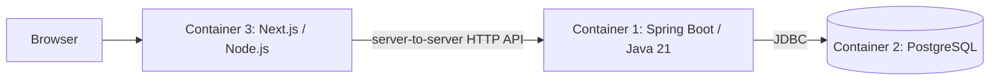

# D3-01：Container構成・起動契約案（2026-11-05）

**方式2の実装順序：** 具体化案・DB整理のOwner了解を経て、[5段階のタスク計画](phase4-d3-option2-staged-task-plan-20261109.md)へ作業順・検証・終了条件を整理した。実装開始は各段階の判断に従う。

**2026-11-09の方式2入口：** main `cf77a3c`（PR #61統合後）を基点に、新規branchで[方式2の実装・有限検証条件](phase4-d3-option2-implementation-conditions-20261109.md)を具体化する。方式1の改善・自宅／Cloud結果は各結果文書を優先し、方式2は文書計画段階を維持する。下記§2のsource／health／Container資材は2026-11-05の設計時点の棚卸しであり、現行mainの不存在を意味しない。

## 1. 目的・状態・今回の範囲

**現行状態：** 設計を`ded2698`へcommit後、Owner指示で方式1を実装・限定検証した。[結果](../architecture/validation/phase4-d3-integrated-container-results-20261105.md)はimage build・起動・実SPA journey／DB／Audit・再起動／DB回復・cleanupの限定技術成立。結果Owner受入は未記録。方式2は構成検討段階を維持する。以下の未実装・未実証表示は設計時点の契約案であり、現在の実行範囲・未実施は結果文書を優先する。

Owner指示により、main `c224b146ea615e61bb1b89ea6fd1e17060581cb9`から`docs/d3-01-container-contract-20261105`を作成し、文書の現状追随後にD3-01の検討へ進んだ。[統合計画§9](phase4-review-integrated-task-plan-20261020.md#9-初期標準確立に向けた見直し推進計画owner-approved2026-10-23)のE1→D3の順序に従う。

続くOwner指示で、Next.js frontendからJava APIを利用する構成も有力な第2候補としてD3-01の設計対象へ追加した。第1候補だけでD3の配置検討を完了とせず、両候補の通信・認証・build／run契約と検証条件を整理する。Next.js／BFFの実装開始や認証方式の最終採用は、この構成追加の指示と分けて扱う。

**現行追加方針：** Ownerは第2候補のlocal検証IdPとしてKeycloakをContainer化し、SSOをContainer内サービスで検証する構成を希望した。[Keycloak 4コンテナSSO環境案](phase4-d3-keycloak-sso-environment-20261105.md)を詳細設計の入口とする。localはC-BFF＋OIDCを選定し、Keycloak／Next.js BFF／Java API／PostgreSQLの4サービスを対象にする。実案件のIdP製品・SSO方式・本番採用は別判断で、以下の3サービス図は外部IdPを除く基本配置を示す。

| 項目 | 位置づけ |
| --- | --- |
| Phase／status | Phase 4の個別package D3-01。Phase 4全体の開始・完了認定は変更しない |
| Ownership | Referenceがアプリ構成、Toolingがimage／local検証資材・証拠、platformが実ECS・TLS／network・運用条件を所有。案件frontend・業務はCustomer-owned |
| 対象 | `koiki-reference-app`と将来の専用Container検証資材。Framework共通API・Starterの一般改修を前提にしない |
| 今回の実施 | source／文書の静的照合、構成比較、起動契約案・不足入力・後続検証条件の文書化 |
| 後段 | D3-02の資材作成・image build／local起動と有限検証、D3-03の実ECS。実行範囲・資源・停止／cleanup条件を具体化してから進める |

今回はDockerfile／Compose／application code／POM／CIを変更せず、image pull／build／push、DB／container起動、ECS操作、追加Maven実行を行っていない。commit／push／PR／merge／tagも未実施。

## 2. 確認できた現在地

| 確認対象 | source／Evidenceと意味 |
| --- | --- |
| source baseline | main／origin/main／GitHub mainは`c224b14`。PR #59統合済み、通常CI・Java Runtime Compatibility・VT Compatibilityがsuccess。現行checkpointは`checkpoint/v0.1.8-phase4-development-baseline`。[E1結果§6](../architecture/validation/phase4-e1-regeneration-and-publication-20261103.md#6-main統合現行checkpointの照合2026-11-05) |
| E1配布版 | `framework-0.1.0-preview.1`はFrameworkの14 POM＋12 JARであり、実行可能Reference appやContainer imageの配布ではない。公開版・hashは変更しない |
| 実行可能JAR | [Reference POM](../../koiki-reference-app/pom.xml)はBoot repackageを使用。checkout版は`0.1.0-SNAPSHOT`。ファイル名だけでは固定断面にならないためsource SHA・JAR SHA-256を別途記録する |
| frontend | 同POMの`b1-session-spa`でfrontendをbuildし、`META-INF/resources/spa`へ格納。[package.json](../../koiki-reference-app/frontend/package.json)はNode `24.19.0`／npm `11.9.0`を指定。通常packageだけでSPAが入るとは扱わない |
| health | Reference POMにObservability Starterの明示依存はない。既存[Observability defaults](../../koiki-starters/koiki-starter-observability/src/main/java/org/koikifw/starter/observability/internal/KoikiObservabilityDefaultsEnvironmentPostProcessor.java)にはhealth公開・probe有効化の設定があるが、Referenceへの実効適用は未確認 |
| Security | [Reference browser chain](../../koiki-reference-app/src/main/java/org/koikifw/reference/identity/configuration/ReferenceSecurityConfiguration.java)はhealth経路を対象にしない。[Framework fallback](../../koiki-starters/koiki-starter-security/src/main/java/org/koikifw/starter/security/internal/KoikiSecurityAutoConfiguration.java)は未定義経路をdenyAll。Actuator追加だけで匿名probeが成功するとは扱わない |
| DB／migration | [Reference設定](../../koiki-reference-app/src/main/resources/application.properties)は`kkref` migration／`kkref_flyway_history`。[Data Starter](../../koiki-starters/koiki-starter-data/src/main/java/org/koikifw/starter/data/internal/KoikiDataFlywayAutoConfiguration.java)は同DataSourceでKOIKI migration後にapplication migrationを実行する |
| secret | Referenceはlogin-attempt用HMAC key ID／keyを外部入力として要求する。SessionはJDBC永続化。認証fixtureをimageへ焼き込む構成は採らない |
| Container資材 | Git追跡対象にDockerfile／Compose／dockerignoreは見つからない。既存のhost JVM＋Testcontainers検証を、app自体のContainer実証として数えない |

## 3. 配置方式とbuild方式の比較

### 3.1 frontend／backend

| 案 | 利点・追加責務 | D3初回の提案 |
| --- | --- | --- |
| A：SPA静的asset＋MVCを同じJava JARへ格納 | 既存B1資材を再利用できる。単一originでSession／CSRF境界を維持し、実行時Nodeを不要にできる | **第一候補**。`b1-session-spa`を明示してbuildし、同梱を検証する |
| B：静的frontendを別containerへ配置 | 個別更新が可能。reverse proxy・route・cache・同一originの設計と結合検証が増える | 案件に個別配置の要求が出た時に差分として検討 |
| C：Next.js frontendとJava APIを別containerへ配置 | 個別build／deploy、SSR／BFFに対応する構成。ブラウザからAPIまでの経路・認証終端・Session／tokenの責任を設計する | **第2候補／今回の構成設計対象**。§3.3〜3.4で3コンテナ構成と起動契約の差分を整理する |

第1候補の初回検証は既存Referenceのlocal Session認証を用い、browser→単一Java app→専用PostgreSQLの構成を提案する。第2候補のNext.js配置・認証境界は以下で別に設計する。[frontend認証選択ガイド](frontend-authentication-profile-guide.md)の選択肢を全案件への採用決定とは扱わない。

### 3.2 image作成

| 案 | 特徴 | 今回の提案 |
| --- | --- | --- |
| 固定済みJARをruntime imageへCOPYするDockerfile | JAR照合とimage作成を分け、E1のartifact識別と接続しやすい。UID・書込先・signalを明示できる | **第一候補**。専用stagingのJARを`app.jar`へ単一名で配置し、曖昧なwildcard選択を避ける |
| multi-stageでMaven／Node buildもContainer化 | build環境も固定できるが、依存取得・proxy／CA・cache・frontend toolchainの管理が増える | runtime成立後に再現性要件に応じて検討 |
| Boot Buildpacks | buildpack／builderでimage作成を管理できるが、builder／run image／lifecycleの識別と挙動確認が別途必要 | 今回は比較候補として保持し、併行実装しない |

第一候補はTemurin Java 21のUbuntu系JRE image。既存Java 21生成物との対応と診断の容易さを重視する。**正確なpatch tag・OS variant・digest・対応architecture・取得可否は未確定**であり、実在や利用可能性をこの文書で保証しない。D3-02前に公式imageを調べ、タグ＋digest、Java実版、OS、platformを固定する。Java 25／VTを初回条件へ追加しない。

### 3.3 第2候補：Next.js frontend＋Java API＋PostgreSQL

| コンテナ | 役割・runtime | 公開・接続案 |
| --- | --- | --- |
| 1：`backend` | Spring Boot APIサーバー、Java 21 runtime。業務Use Case／Domain／認可／DB／Auditを所有 | 内部`8080`候補。Next.js serverからHTTPで呼ぶ。業務DBへの接続はbackendが所有 |
| 2：`db` | PostgreSQL。業務・Identity・Audit等を保持 | 内部`5432`、専用volume。browserへ公開せず、Next.jsから業務tableへ直接接続しない |
| 3：`frontend` | Next.js frontend、Node.js runtime。画面／SSR、採用時はBFFを所有 | 内部`3000`候補。localではloopbackの空きportを公開し、本番のTLS／reverse proxyはplatform契約として定める |

図はNext.js serverを経由する基本経路。local検証では別途Keycloakを加えた4サービスのC-BFF＋OIDCを選定する。Next.jsが別案件repo／別運用基盤にある場合、Framework側の管理対象はbackend＋DBの2コンテナでもよい。その場合も外部Next.jsからの接続契約を保持し、Next.jsを含む結合結果は別環境で取得する。全サービスを同じrepo／ECS taskへ同居させる決定は行わない。

Next.jsの採用だけではBFF方式を意味しないため、次の2方式を分けて選定する。第2候補内の認証設計は[既存ガイド§6](frontend-authentication-profile-guide.md#6-profile-b--nextjs-bff)と[REST差分台帳](KOIKI-JavaWeb-FW_Phase4_PL1_REST利用境界差分台帳_v0.1.md)へ接続する。

| 方式 | Browser→frontend | frontend→backend | 設計判断 |
| --- | --- | --- | --- |
| C-BFF：Next.jsがBFFを担う | BFFのSession Cookie。Next.jsがlogin・CSRF・Session／token lifecycleを所有 | server側で保持した利用者Access TokenをBearerとして送る。JavaはResource Serverとして検証 | **第2候補のlocal SSO検証方式に選定**。KeycloakをIdPとし、issuer・audience・claim、BFF専用DB・logoutの詳細は4コンテナ環境案へ具体化。実案件採用は未確定 |
| C-Session：Next.jsが画面／中継を担いJavaがSession認証を所有 | 同一originの公開routeを使い、Javaのlogin／Session Cookie／CSRFを維持 | 許可したroute・Cookie・CSRFの転送契約を定義。SSR時の利用者Session受渡しを明示 | BFF認証を採らない場合の比較案。Set-Cookie・path／domain・logoutの透過、proxyの責任を別途実証 |

BrowserがJava APIを別originへ直接呼ぶ方式は上の図と異なる。採用する場合は公開API origin・CORS・Browserのcredential・CSRFを追加設計し、Next.js serverからの呼出しと混同しない。

C-BFFではBFFを認可の迂回路にしない。Javaは要求ごとにJWT・利用者link・現在Permission／業務scopeを検証し、ID TokenやBFF内部Session CookieをBearerの代わりに使わない。既存[Reference API chain](../../koiki-reference-app/src/main/java/org/koikifw/reference/identity/configuration/ReferenceApiSecurityConfiguration.java)は`api-bearer`の明示有効化とissuer／audienceを要求し、`token_use=access`・Reference固有権限も検証する。任意のIdPへ設定だけで接続できるとせず、採用IdPのclaim対応を照合する。

実案件の外部IdP製品・実環境・費用・接続条件は未指定。local検証はKeycloakを第4コンテナとし、同じPostgreSQL内でKOIKI・BFF Session／token・KeycloakのDB／roleを分離する案を選ぶ。単なる署名token／issuer stubで実OIDC login／refresh／SSOを代用せず、2つの独立ClientでSSOを確認する。実案件で別storeを選ぶ場合は依存サービス数とcleanup設計を更新する。

### 3.4 第2候補のbuild・起動契約差分

§4のJava／DB共通契約に、次の差分を加える。

| 項目 | 第2候補の契約案・確定事項 |
| --- | --- |
| Java artifact | SPA同梱を前提にせず、`b1-session-spa`なしのclean stagingでAPI用JARを生成・固定する。既存ReferenceにはMVC routeもあるため、profileを外すだけでAPI専用になるとは扱わない。外部から到達可能なrouteを限定し、Java直通・MVC／login／Session API経路の公開可否を認証方式別に定める |
| Next.js artifact | Next.js／Node.js／package managerの版・lockfile・base digest・source SHA・image IDを固定する。第1候補のReact／Vite資材やNode版をそのままNext.jsの採用版としない。実案件frontendが未準備なら、契約検証用Tooling frontendを使うかを実装前に決める |
| Node起動 | production build＋`output: 'standalone'`／`node server.js`を候補とし、必要な`public`と`.next/static`も格納する。非root・`0.0.0.0` bind・`PORT=3000`候補。開発serverは使用しない。正確な版とbuild設定は採用時に確認 |
| 接続先 | server専用設定`KOIKI_API_BASE_URL=http://backend:8080`を候補とする。SSR／BFFはcontainer DNS名を使い、browserは公開frontend originだけを使う。container内`localhost`をbackend接続先にしない |
| 設定・secret | backend内部URL・client secret・tokenをBrowser用bundleや公開設定へ入れない。`NEXT_PUBLIC_*`はbuild時に公開bundleへ入るためsecretに用いない。認証用server設定はruntime外部供給し、build時の実API／実secret接続を前提にしない |
| network | frontend↔backend用とbackend↔DB用のnetworkを分ける案を優先し、frontendの業務DB接続を不要にする。BFF storeにDBを使う場合は専用roleと接続境界を追加する。backend／DBのhost公開は原則不要で、probeはToolingから内部到達できる方式を決める |
| TLS／認証 | Browser→frontendは本番HTTPS・Secure HttpOnly Cookieを前提に設計。内部HTTPはlocal隔離環境の条件とし、実ECSの内部TLS要否は別判断。信頼proxy・forwarded header・公開callback URLは外部originに整合させる |
| API契約 | 最小の読取＋更新journey、DTO・version・Problem Details／業務code、401／403・競合応答を対応付ける。BFFが業務ルールを複製しない。転送先は固定し、任意URL／任意credentialの中継入口にしない |
| cache／Session | 個人別API応答・token・認証済みSSR／BFF結果を共有cacheへ入れない契約を定める。Next.js機能に応じた書込cache／一時領域を列挙し、Javaのread-only filesystem設定をNodeへ一律転用しない |
| health／起動順 | DB→Java→frontendの順で到達性を確認。frontend livenessはNode自身、readinessは必要なbackend依存を区別し、依存停止で再起動連鎖を起こさない。frontendは認証済み利用者probeなしでも状態判定できる限定endpointを設ける案。Composeの起動順だけをreadiness保証としない |
| timeout／停止 | Next.js→Javaの接続／応答上限、browser向けtimeout、処理中要求・SSR／streamingの扱いを定める。更新要求を自動再送しない。受付停止→frontend処理排出→backend停止→DBの順を候補とし、NodeのSIGTERM・各終了猶予はJavaと別に実測する |
| 観測／更新 | frontendとbackendのrequest ID伝播・値検証・token非露出、DB／Auditとの照合を定める。frontend／backend imageは個別固定し、対応組合せ・API互換性・片側更新／rollback条件を記録する |

Node起動／standalone資材は[Next.js output公式資料](https://nextjs.org/docs/app/api-reference/config/next-config-js/output)、公開設定・cache／self-host条件は[Next.js self-hosting公式資料](https://nextjs.org/docs/app/guides/self-hosting)、server側中継と認証責任は[Next.js BFF公式資料](https://nextjs.org/docs/app/guides/backend-for-frontend)を参照した。これらは調査時点の資料で、Next.js採用版の固定・実際のimageでの確認は後段に残る。

## 4. 第1候補の起動契約案とJava／DBの共通事項

以下は採用案であり、設定済み・実証済みを意味しない。

| 項目 | 提案する契約 | D3-02で残す確認 |
| --- | --- | --- |
| artifact識別 | source SHA・dirty差分／hash、JAR hash、frontend lockfile／build record、base digest、image IDを対応付ける。Reference appをE1のFramework ZIPと区別 | image中JARのhash一致、SPA同梱・async無効。旧生成JARを無条件に使い回さない |
| runtime | Linux container、初回platformは`linux/amd64`を候補としhost対応をpreflightで確認。非root UID、固定workdir、exec formで`java -jar /app/app.jar` | JavaがPID 1としてsignalを受けること、実UID、実platformを確認 |
| filesystem | app/imageは不変、root filesystem read-only、必要な一時書込は専用`/tmp`。ログはstdout／stderr。DBは別container・専用volume | 書込不足での失敗を識別。volumeを保持した再起動と最終cleanupを区別 |
| network | app内部port `8080`を候補とし、host公開はloopbackの空きport。DBは専用network内で接続しhostへ公開しない | appからのDB DNS／接続、公開port／所有network、他サービス非干渉 |
| 設定／secret | DB URL／user／password、HMAC key ID／keyは外部供給。secretはimage layer・build arg・Gitへ入れない。読取専用config tree等で供給し、出力へ値を残さない | 必須secret欠落時の起動失敗、mount権限・実効設定。証拠はkey名・供給方式だけ |
| DB／migration | 初回は使い捨てPostgreSQL 17系を候補としてdigest固定。同一DataSource／既定schema、KOIKI→Referenceの現行migration順を維持。1 appのみ起動 | 二つのhistory・Session table・Reference table、初回と同DB再起動時の状態。migration失敗をreadyにしない |
| Session／CSRF | 既存のJDBC Session・HttpOnly・SameSite・CSRF検証を維持。frontendの呼出先はsame-origin | 未認証拒否、login→認証済みread、CSRF欠落拒否と正常更新、logout／Cookie削除を選択検証 |
| TLS／proxy | 初回local HTTPはloopback専用の試験条件として分離。Secure Cookieの実証はTLS終端＋HTTPS経路で別checkpointにする。forwarded headerは信頼proxy経路を決めてから採用 | HTTP結果をF2の実Cookie／proxy成立へ一般化しない。HTTPS確認をD3-02内で行うか後段へ残すかは開始前に決める |
| health | 同じapp portの`/actuator/health/liveness`と`/actuator/health/readiness`のGETだけを匿名probe候補にする。details／componentsは非表示。その他Actuator経路・メソッドを許可しない | probe成功、他経路拒否、認証画面へのredirectなし、secret／構成詳細非露出 |
| readyとlive | livenessはアプリ生存状態、readinessは`readinessState,db`を候補にする。DB停止でreadyは失敗、liveはDB非依存とする | 起動途中・DB停止・DB回復を区別。Docker health状態だけで自動再起動・traffic制御が成立すると扱わない |
| 観測 | Observability Starterの限定追加を第一候補にし、構造化stdoutとhealthを利用。OTLP exporterは追加しない | 有効依存・設定・logを確認。D1の正式Collector／backendや非同期trace成立へ拡張しない |
| 終了 | SIGTERMでgraceful shutdown。Bootのphase別待機を20秒、local containerのstop待機を40秒の候補とする。合計終了時間は実測し、複数phaseのため超過するなら再調整 | 処理中要求・新規受付・終了code／時間・DB結果。20秒で全process終了すると仮定しない。強制終了は別に分類 |
| restart | 同一image・同一設定・同一専用DBでappを再起動。業務値・Audit・migrationの重複や不整合を確認 | 失敗した業務要求は自動再送しない。Session継続は実結果を記録し、可用性／複数task運用の保証にしない |

Docker exec formとsignalの関係は[Dockerfile reference](https://docs.docker.com/reference/dockerfile/#entrypoint)、digest固定の意味は[Docker build best practices](https://docs.docker.com/build/building/best-practices/#pin-base-image-versions)を参照。healthは[Boot 4.1.1 Endpoints原本](https://github.com/spring-projects/spring-boot/blob/v4.1.1/documentation/spring-boot-docs/src/docs/antora/modules/reference/pages/actuator/endpoints.adoc)、終了は[Boot 4.1.1 Graceful Shutdown原本](https://github.com/spring-projects/spring-boot/blob/v4.1.1/documentation/spring-boot-docs/src/docs/antora/modules/reference/pages/web/graceful-shutdown.adoc)と照合した。Context7の隣接版4.1.0も参照したが、採用版4.1.1の原本を判断根拠とする。

## 5. health成立に必要な最小差分案

現状の設定を流用するだけではhealth公開は成立しない。以下を次の詳細化対象とする。

1. ReferenceにD3専用のMaven profileでObservability Starterを追加する案を検討する。通常buildに常設するかは必要性を確認し、既存CI／配布unitへ黙って追加しない。
2. Reference-ownedのD3専用runtime profileで、probe有効化、公開health限定、details／components非表示、readyにDBを含める設定を供給する。
3. 同profileだけで有効なReference-ownedのSecurity chainを追加する案とする。GETの上記2経路だけを許可し、既存browser／Session APIのchainとfallbackを維持する。`/actuator/**`全体のpermitAllやCSRF全体無効化は行わない。
4. 非D3構成の回帰、D3でのprobe／拒否の差分を検証する。runtime profileの付け忘れ・依存profileとの不一致は、健康と誤認しないよう起動記録・probeで識別する。

Framework変更必須という根拠は現時点ではない。必要が判明した場合は理由・最小差分・影響集合を提示してから対象を見直す。これは実装済みの説明ではない。

## 6. D3-02へ渡す検証案と実行前の確定事項

第1候補とJava／DBの共通検証は次の8群、第2候補の差分は後述のNX01〜04を候補とする。認証方式によってDC03等の期待値を分ける。件数・実行時間・資源枠・実装ファイル数は、fixture／環境の静的確認後に具体化する。旧S1／D2の予算や実行承認は流用しない。

| ID | 選択する確認群 | 合格判断の材料 |
| --- | --- | --- |
| DC01 | source／JAR／frontend／imageの識別 | 固定値と実物の対応、非root・platform・async無効 |
| DC02 | 初回起動・migration・ready／live | 空の専用DBで起動完了、historyとtable、probeのHTTP／body |
| DC03 | 同梱frontend・認証／CSRF境界 | SPA取得、Session journey、拒否・正常更新・logoutのHTTP／DB／Audit |
| DC04 | healthのSecurity／情報露出 | 匿名GETの限定許可、他経路・メソッド拒否、detailsなし |
| DC05 | 必須secret欠落・DB未準備 | 起動失敗／非readyの区別、timeout、secretを含まない診断 |
| DC06 | DB停止・回復 | liveとreadyの分離、回復後ready、業務の自動再送なし |
| DC07 | SIGTERM・同DBへの再起動 | 処理中要求の結果、終了／強制停止判定、再起動後のDB整合 |
| DC08 | cleanup・証拠照合 | 今回所有のcontainer／network／volume／secretファイルだけをcleanupし、残留なしを確認 |

| ID | 第2候補で追加する確認群 | 合格判断の材料 |
| --- | --- | --- |
| NX01 | 3コンテナ／外部Next.jsとの接続・build識別 | Node／Javaそれぞれのsource・版・image固定、静的asset／SSR、内部DNS／公開origin、業務DB直通なし |
| NX02 | 採用した認証方式の正常・拒否・終了 | C-BFFならBFF Session／CSRF、Bearer検証・401／403、token非露出、logout／失効。C-SessionならCookie／CSRF／Set-Cookie／SSR受渡し。fixtureと実IdPの結果を分離 |
| NX03 | 利用者分離・障害／更新 | 2利用者のSSR／API結果とcache分離、backend停止／timeout時の応答・相関、更新の重複なし、片側更新のAPI整合 |
| NX04 | 各containerの停止／再起動・cleanup | Node／Java個別signal・終了猶予、BFF store採用時のSession再起動挙動、DB整合、追加secret／fixtureを含む所有物残留なし |

実行前には、Docker contextとLinux container可用性、正確なbase／DB image digest、JDK／Node／npm・依存取得条件、host空きport、UID／mount、TLS確認範囲、health-check実行主体とimage内toolの要否を確定する。全containerにHTTP clientがあるとは仮定せず、初回はTooling側からHTTP観測する案を優先する。

さらにapp／DB／browser・検証JVMに加え、第2候補のNode／issuer fixture／BFF storeを含むCPU／memory／connection数、phaseごとの時間上限とcleanup予約、試験データ／secretの生成方法、所有物台帳、失敗時停止・再実行条件を明記する。構成の選択と実行条件の具体化前に動的実行しない。通常rootや既存専用suite全件の反復をD3の開始条件にしない。変更の直接影響に応じた回帰集合を選ぶ。

## 7. D3-03への引継ぎと未確定事項

| 判断対象 | 現時点の提案／不足入力 | 主な責任 |
| --- | --- | --- |
| 構成候補 | 第1：同梱SPA＋Java21＋専用PG。第2：Java API＋専用PG＋別Next.js／Node。両候補の構成設計を行う。local実装・検証の順序は範囲確定時に決める | Reference／Tooling／Customer、Owner |
| 第2候補の認証・frontend | localはKeycloak＋C-BFF／OIDC、Tooling frontendとBFF専用PostgreSQL DBの案。2 ClientでSSOを検証する。Next.js／OIDC libraryの採用版・具体実装と、実案件IdP／外部Next.jsの管理境界は未確定 | Customer／IdP担当／Reference／Tooling |
| health最小差分 | §5のprofile限定依存・設定・Security案。正確なpath／matcher／有効化条件・回帰集合を詳細化 | Reference／Tooling |
| TLS／Cookie | local HTTPとHTTPS／信頼proxyの検証範囲を確定。F2を未検証のままPASSにしない | Reference／platform |
| ECS方式 | account／region、Fargate／EC2、CPU architecture・task資源、ECR等のimage格納先は未指定 | platform、Owner |
| 接続・運用 | VPC／subnet／SG、ALB／TLS／DNS／認証終端、DB／secret供給、IAM／logs、費用・終了／削除条件は未指定 | platform、Owner |
| migrationの本番責務 | 初回1 appでの起動時migrationとは別に、実ECSのtask多重起動・DDL権限・実行主体・失敗／rollback判断を設計 | application／DB運用／platform |
| 配布と更新 | D3の追加依存が公開済みFramework binaryの変更を伴うか照合し、必要なら新しい版を判断。Reference imageの配布方針は別判断 | Framework／Tooling、Owner |

local成功で実ECSのprobe／ALB traffic制御・drain・stop timeout・複数task／rolling update成立を代用しない。D3-03はplatform入力を得て差分を設計し、実演・費用・cleanupの条件を定める。

E1-V09限定技術PASSは維持し、実案件受領V10は案件準備後に別途確認する。D1結果受入未記録、S1未達／人手HOLD、C2 H07、正式support・全DoD／Phase4全体の未完了も維持する。

**次の作業：** 第1候補と§5のhealth差分案を保持し、第2候補は[Keycloak 4コンテナSSO環境案](phase4-d3-keycloak-sso-environment-20261105.md)からhostname到達性・採用library／版・realm／claim／DB契約・対象ファイル／直接回帰・実行条件を具体化する。D3-01の完了判定は両候補の起動契約・残る入力・D3-02への条件が確認できた段階で記録し、本案だけで完了にしない。
