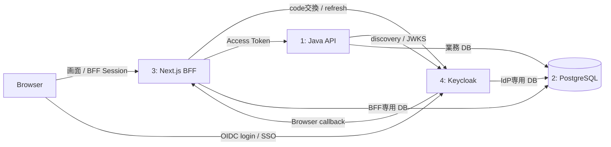

# D3：Keycloakを含む4コンテナSSO検証環境の構成案（2026-11-05）

## 1. 目的と今回の判断

Ownerは、外部IdP連携を想定するNext.js BFF＋Java API＋PostgreSQLの第2候補について、OSS IdPのKeycloakをContainer化し、SSOをローカルで検証できる環境を構成する方針を示した。本書でIdP製品と認証方式を具体化し、[D3-01](phase4-d3-01-container-contract-20261105.md)の詳細設計入口とする。

**状態：構成・起動／検証契約案。Compose・BFF等の実装と実起動は未実施。** 今回は既存sourceと公式資料の照合、設計・入口文書の更新を行った。Keycloakは検証対象であり、Frameworkの必須依存・提供artifact・本番IdP採用にはしない。第1候補の同梱SPA＋Java／DB構成も保持する。

「コンテナ完結」はアプリ・DB・IdPの実行サービスをlocal Container内に置き、実企業IdP／SaaS認証へ依存しない意味とする。browser／検証runnerはhost上でよい。image・Maven／npm依存の初回取得、DNS／証明書の準備までofflineで完結するという意味ではない。

## 2. サービス配置・所有・DB分離

| コンテナ | 内容 | 責務・接続 |
| --- | --- | --- |
| 1：`backend` | Spring Boot／Java 21 API | Bearer JWT検証・利用者link・現在権限・業務・Audit。`koiki_app` DBへ接続 |
| 2：`db` | PostgreSQL 17系候補 | `koiki_app`、`koiki_bff`、`koiki_keycloak`の3 DBと専用roleを分離。hostへDB portを公開しない |
| 3：`frontend` | Next.js／Node.js、検証用BFF | OIDC Client、画面／SSR、Browser Session、server側token保管・更新。APIをbackendへ送信。Session／token用`koiki_bff`だけに接続 |
| 4：`keycloak` | Keycloak | realm・OIDC client・検証利用者・SSO Session・JWT発行。`koiki_keycloak`だけに接続 |

検証資材はTooling-ownedで`build-support/container-sso-verification/`を配置候補とする。Next.jsはCustomer-owned BFFの契約を試す専用fixtureで、正式業務frontendをFrameworkへ移さない。Javaは既存Referenceの明示Bearer構成を再利用する案とし、最小変更が必要ならReference-ownedのprofileへ限定する。Root Reactor／CI・Framework Public API・既存Release ZIPは変更対象にしない。

初回DB作成は専用初期化処理だけが管理roleを使い、runtimeの3利用者へ管理roleを渡さない。KOIKI／Referenceのmigration、BFFのSession migration、Keycloakのschema管理はそれぞれの所有者が行う。同一PostgreSQLを共有するため障害は連動する。この構成で本番の可用性・性能・独立運用を保証しない。

## 3. URL・issuer・local通信契約

| 対象 | 候補値・扱い |
| --- | --- |
| frontend公開origin | `http://localhost:13000`。host公開は`127.0.0.1:13000`、container内部は`3000` |
| Keycloak公開origin | `http://idp.localhost:18080`。host公開は`127.0.0.1:18080`、Keycloak自身も内部`18080`でlistenする |
| realm／issuer | 専用realm `koiki-d3`、issuer `http://idp.localhost:18080/realms/koiki-d3` |
| Container内IdP到達 | Keycloakにnetwork alias `idp.localhost`を付け、同じhostname・portで到達させる。`KC_HOSTNAME`は公開originの完全URLに固定 |
| backend内部 | `http://backend:8080`。BFF専用設定で保持し、Browser bundleへ埋め込まない |
| 管理・health | Keycloak管理操作はloopbackの検証環境だけ。management／healthのportはhostへ公開せずToolingから限定到達 |

この候補は、browserが`.localhost`をloopbackへ解決し、Containerでは同名をDocker DNSが解決することを前提とする。**実環境での解決・接続は未確認で、実装前preflightで確認する。** 非対応時は共通の検証hostnameとhost側名前解決を設計し直す。hostsファイルや全体DNSを自動変更しない。

`localhost`と`keycloak`で異なるissuerを設定したり、JWTのissuer検証を無効にして到達性問題を回避しない。discoveryの`issuer`・authorization／token／JWKS URLをBrowser／BFF／Javaから照合する。公開と内部portを一致させ、初回は動的backchannelやhost gateway経由を必須にしない。[Keycloak hostname公式資料](https://www.keycloak.org/server/hostname)

HTTPは使い捨てlocal検証の条件であり、local realm／BFF設定へ限定する。CookieのSecure属性を有効にしたHTTPS実証・信頼CA・proxy経路は別checkpointとし、HTTP検証で実Cookie条件F2を完了にしない。token／secretを実データにしない。TLS検証のためproxy containerが必要なら、4実行サービスに加える検証インフラとして数と資源を明記する。

## 4. OIDC・SSO・利用者認可の契約

### 4.1 OIDC ClientとSession

Authorization Code＋PKCE S256を用いるconfidential BFF Clientを候補とし、state・nonce・署名／issuer／audience等の検証は採用するOIDC libraryへ委ねる。password grant／implicit flowをSSOの代わりにしない。client secret、Access／Refresh TokenはBFF server側だけで扱い、BrowserにはopaqueなSession ID Cookieを渡す。

Next.js／Node.js／OIDC・Session／PostgreSQL libraryの正確な版とlockfile、Cookie／CSRF・refresh競合・失効処理は実装前に固定する。既存React／Vite資材をNext.js実装済みと扱わない。Session／tokenはBFF専用DBへ保存し、ログ・HTML・公開JavaScriptへ出さない。認証済みSSR／APIは利用者間で共有cacheしない。

### 4.2 SSOを確認する2つの独立Client

| 項目 | Client A | Client B |
| --- | --- | --- |
| Keycloak client ID | `koiki-next-a` | `koiki-next-b` |
| 検証画面のnamespace | `/a` | `/b` |
| 正確なcallback候補 | `http://localhost:13000/a/auth/callback` | `http://localhost:13000/b/auth/callback` |
| BFF Session | Cookie A、path `/a`、独立Session | Cookie B、path `/b`、独立Session |
| client secret／state／nonce／PKCE | A専用 | B専用 |

Next.jsを1コンテナのまま2つのRP/clientを実装し、Cookie・Session・認証途中のstateを分離する。redirect URI／post-logout URIは正確な列挙とし、wildcard登録を前提にしない。

SSOの確認journeyは、(1)新規browser contextでAにログイン、(2)BのBFF Sessionがないことを確認、(3)同じbrowser contextでBのOIDC認証を開始、(4)KeycloakのSSO Sessionにより資格情報を再入力せずBのcallbackが成功し、B独自Sessionが作成されること、とする。`prompt=none`による無操作認証を選択し、SSO Sessionのない新規contextでは`login_required`等の期待失敗となる対照を置く。BがAのBFF Sessionを読んで認証済みにする実装は合格にしない。

1回のOIDC loginだけの成功は「OIDC連携PASS」、この独立2 Client journeyまで成功して初めて「選択SSO journey PASS」と分けて記録する。これは同一process内の2 RPによる限定実証であり、別運用の実案件間SSO・企業SAML連携の証拠にはしない。[Keycloak OIDC公式資料](https://www.keycloak.org/securing-apps/oidc-layers)

### 4.3 Java APIとのclaim対応

既存[API chain](../../koiki-reference-app/src/main/java/org/koikifw/reference/identity/configuration/ReferenceApiSecurityConfiguration.java)と[claim converter](../../koiki-reference-app/src/main/java/org/koikifw/reference/identity/configuration/ReferenceJwtAuthenticationConverter.java)を静的照合した。初回はJavaの検証を弱めず、専用realmのclient scope／protocol mapperとfixture利用者を次に対応させる。

| 項目 | 初回の対応案・確認 |
| --- | --- |
| `iss`／署名／期限 | §3のissuerとrealm JWKS、実際のtokenで検証する |
| `aud` | 専用API audience `koiki-reference-api`をAccess Tokenへ追加。BFFのclient IDだけで代用しない |
| `token_use` | 専用mapperでAccess Tokenへ`access`を付与する。ID Tokenには付けない。Keycloak標準出力に存在すると仮定しない |
| `koiki_user_id` | 管理者が用意したfixture user attributeとKOIKIの検証利用者UUIDを対応付ける。本人が編集できない管理属性とし、Browserから任意指定させない |
| `scope` | `expense.apply`を文字列scopeとして付与する。realm role一覧だけで同等とみなさない |
| 実効権限 | KOIKI側の利用者がACTIVEかつ現在`EXPENSE:APPLY`を持つことも必要。tokenのscopeだけで許可しない |

対応はKeycloakの専用検証設定であり、汎用IdP claim契約の確定・FrameworkのKeycloak専用化ではない。実tokenで正負を確認し、既存契約に適合しない場合は静的照合結果と必要最小差分を提示する。ID TokenをJava APIへ渡す負例も選ぶ。

### 4.4 logout・更新・障害

local logoutは対象BFF Sessionを削除し、SSO logoutはRP-Initiated Logout等でIdP Sessionを終了する別操作として扱う。Aだけのlocal logout後、BやIdPのSessionが自動消滅するとは扱わない。SSO logout後の既存BFF Session処置はbackchannel logout等の採用有無とともに明示し、単に再認証ができない結果と区別する。

Javaの自己完結JWT検証では、IdP logout直後に発行済みAccess Tokenが即拒否されると仮定しない。短いAccess Token有効期間とrefresh失敗後の再認証、必要なら追加失効機構を区別する。初回は有効期間内・期限後の実結果を記録し、全Session即時失効を認定しない。

Keycloak停止で新規login／refreshが失敗する経路と、既存JWT・cache済みJWKSでAPIが動作し得る経路を分ける。依存障害からcontainer再起動の連鎖や業務更新の自動再送を起こさない。

## 5. image・起動・初期化・停止案

Keycloakの公式getting-startedで調査時点の例は`quay.io/keycloak/keycloak:26.8.1`。これを初回候補にするが、実際のimage digest・platform・取得可否は未確認である。PostgreSQL／Java／Nodeも正確な版・digestを実行前に固定する。[Keycloak Docker公式資料](https://www.keycloak.org/getting-started/getting-started-docker)

Keycloakの初回はlocal限定`start-dev --import-realm`、専用PostgreSQL、固定hostname／portを候補とする。master realmは管理だけ、検証は`koiki-d3` realmだけを使う。bootstrap admin・3 DB用password・2 client secret・検証利用者password・BFF暗号鍵は実行ごとに生成し、ignored領域へ保持する。realm templateに実secretをcommitしない。正式production構成は別設計とする。

realm importは既存realmを毎回更新する仕組みとして扱わない。初回import・再起動・設定変更の反映を区別し、既存realm／volumeを黙って削除・上書きしない。[Keycloak realm import公式資料](https://www.keycloak.org/server/importExport)

起動順は、(1)専用DB／role作成・PG ready、(2)Keycloak起動・realm／discovery／JWKS確認、(3)Java migration・専用利用者seed・API ready、(4)BFF Session migration・Next.js readyを候補とする。静的build中にKeycloakの稼働や実secretを必要としない。

Keycloakのhealthは対象版のhealth有効化・management portを確認して使う。imageにcurlがあると仮定せず、discovery到達と内部health観測を分離する。停止はfrontの受付停止・処理排出後にbackend／Keycloakを終了し、最後にDBを終了する。SSO Session・BFF Sessionの保持を確認する再起動ではvolumeを残し、最終cleanupと区別する。

## 6. 検証集合・資源・停止条件の具体案

以下はD3-02向けの実装／検証計画案であり、実行済み・合格結果ではない。既存DC／NX群と重複する確認は同じ証拠へ対応付け、別の網羅全件を追加しない。

| ID | 主な確認 | 期待する判定材料 |
| --- | --- | --- |
| KS01 | 4 image／設定／network／3 DBとrole | 固定値・所有物台帳、他DB非アクセス、公開portの限定 |
| KS02 | canonical issuerの到達・discovery／JWKS／import | Browser・Next.js・Javaで同じissuer、実際のendpoint／claim整合 |
| KS03 | AのCode＋PKCE login→API read／更新 | BFF Cookie、server側token、利用者・業務値・Auditの対応 |
| KS04 | Bの独立Client SSO・Sessionなし対照 | 再入力なし／独立Session、SSO Sessionのないcontextの失敗 |
| KS05 | JWT／権限の負例 | 誤audience、ID Token、scope不足、無効／権限不足のKOIKI利用者の拒否。既存token単体testを全件重複実行しない |
| KS06 | 2利用者／CSRF／秘密情報非露出 | SSR／cache／Sessionの分離、更新拒否、HTML／log／bundleへtokenが出ない |
| KS07 | refresh・期限・local logout／SSO logout | BFF・IdP・発行済みJWTそれぞれの実結果と保証限界 |
| KS08 | IdP／backend／DBの停止・回復 | 新規login／refresh／API／readyの区別、再起動連鎖・更新再送なし |
| KS09 | SIGTERM・同volume再起動 | Node・Java・Keycloak・DBの終了時間・状態保持、migration重複なし |
| KS10 | cleanup・証拠固定 | 今回所有のcontainer／network／volume・secretだけをcleanup。未解決失敗・残留はHOLDで記録 |

初回資源案はbackend 1.5 GiB／1 CPU（heap 768 MiB）、Keycloak 1.5 GiB／1 CPU、Next.js 1 GiB／1 CPU、PG 1 GiB／1 CPU。PG `max_connections=24`候補、各runtime poolは最大4を候補とし、実際の初期／最小poolも含め余裕を照合する。browser／build JVM・Nodeは別計上し、buildとruntime検証を非並走にする。hostの空き資源が不足なら起動しない。

検証枠は初回70分（cleanup10分を含む）を候補とする。これは旧S1／D2の予算を流用した許可ではなく、実装量・build時間・初期化時間を確認して実行前に確定する。失敗時は当該phaseで停止して診断・cleanupし、root／browser／image buildを自動反復しない。対象外権限・global DNS変更・既存DB／volumeへの操作は行わない。

## 7. 次の具体化と実装対象

実装対象候補は、Tooling配下のCompose・Java／Next.js image定義・Next.js fixture（2 Client）・realm template・3 DB初期化／BFF migration・Reference用fixture利用者seed・秘密情報生成／起動／停止runner・browser検証・結果様式。health追加が必要なら既存D3-01のReference最小差分案と同じ単位で扱う。

次は、(1)canonical hostnameのhost／Docker到達性、(2)Next.js／OIDC／Session libraryと固定版、(3)Keycloak protocol mapper JSONとDB／seed契約、(4)対象ファイル・直接回帰・資源／時間／cleanupの実行条件を具体化する。ComposeやNext.jsの実装・起動結果はこの文書の設計状態とは別に記録する。

E1-V09、実案件V10未完了、既存S1未達／人手HOLD・C2 H07・D1結果受入未記録、正式support／全DoD／Phase4全体の未完了は維持する。企業IdP・SAML federation、MFA、実ECS／本番証明書・可用性・全logout方式は今回のlocal SSO成立から認定しない。
